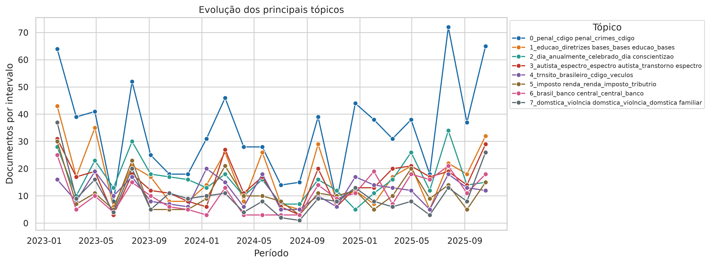

# 🏛️ Mapa Temático do Congresso

[](https://github.com/luanfreitas5/mapa-tematico-congresso-nlp/actions/workflows/ci.yml)
[](https://github.com/luanfreitas5/mapa-tematico-congresso-nlp/actions/workflows/tests.yml)
[](https://luanfreitas5.github.io/mapa-tematico-congresso-nlp/)
[](pyproject.toml)
[](LICENSE)

Modelagem de tópicos e análise de redes com os **dados abertos da Câmara dos Deputados**.

## 🎯 Problema

A Câmara produz milhares de proposições, votações e discursos por ano. Sem uma visão
estruturada, é difícil responder quais temas dominam a agenda, como eles evoluem e como os
atores se relacionam.

## ❓ Pergunta

> Quais **temas** aparecem nas ementas das proposições e nos discursos da 57ª legislatura, como
> sua frequência **muda ao longo do tempo**, e quem são os atores **centrais** nas redes de
> **coautoria** (deputados) e de **alinhamento de votos** (partidos)?

## 📦 Dados

| Fonte (endpoint `api/v2`) | Uso | Camada |
|---|---|---|
| `/deputados` | cadastro (id, partido, UF) | bronze → silver |
| `/proposicoes` (+ `/{id}/autores`) | ementas (tópicos) e coautoria (rede) | bronze → silver |
| `/votacoes` (+ `/{id}/votos`) | votos nominais por partido (rede) | bronze → silver |
| `/deputados/{id}/discursos` | discursos (tópicos) | bronze → silver |

- Dados **públicos**, de agentes públicos, da API oficial; nenhum dado bruto é versionado no Git.
- O e-mail e a foto dos deputados são descartados na silver (minimização, LGPD). Ver o
  [datasheet](reports/datasheets/camara_dados_abertos.md).
- Período e tipos de proposição: [`configs/config.yaml`](configs/config.yaml) (padrão: 2023-02 a
  2025-12; PL, PLP, PEC, MPV).

## 🧱 Arquitetura

```text
API ─▶ bronze (snapshots + manifesto SHA-256) ─▶ silver (pandera) ─┬▶ embeddings ─▶ BERTopic ─▶ gold
                                                                    └▶ redes (NetworkX) ───────▶ gold
```

Detalhes e decisões em [`docs/arquitetura.md`](docs/arquitetura.md).

## 🔁 Como reproduzir

Pré-requisitos: [uv](https://docs.astral.sh/uv/) e Python 3.10+. GPU é opcional (o `pyproject.toml`
aponta o PyTorch para o índice CUDA 12.8; ajuste `[tool.uv.sources]` se usar CPU).

```bash
make install-nlp     # núcleo + pilha de PLN (torch, sentence-transformers, BERTopic, gensim)
make hooks           # pre-commit + baseline do detect-secrets
make pipeline        # ingest → preprocess → topics → networks → evaluate
```

Etapas individuais: `make ingest`, `make preprocess`, `make topics`, `make networks`,
`make evaluate`. Sem o extra de PLN, `make install` basta para ingestão, silver e redes.

- **Idempotência:** `make ingest` reaproveita snapshots existentes; `make ingest REFRESH=1` grava
  um novo snapshot datado (os antigos nunca são alterados).
- **Reprodutibilidade:** semente 42 em tudo, `PYTHONHASHSEED` exportado pelo Makefile, `uv.lock`
  commitado e hash SHA-256 de cada snapshot em `data/bronze/manifest.json`.
- **Testes e qualidade:** `make test` (cobertura ≥ 80%), `make check` (espelha o CI).

## 📊 Resultados

Primeira execução completa, sobre o snapshot da API de **2026-10-22** (semente 42). Números
lidos de `data/gold/` (`coherence_*.parquet`, `doc_topics_*.parquet`, `network_*`).

### Corpus

| Fonte | Registros brutos | Documentos modelados |
|---|---|---|
| Deputados | 882 | — |
| Proposições (PL, PLP, PEC, MPV) | 17.505 | 17.482 |
| Discursos | 44.528 | 44.269 |
| Votações / votos nominais | 34.489 / 415.061 | — |

### Tópicos (BERTopic)

| Corpus | Tópicos (sem ruído) | Documentos no ruído (-1) | c_v (IC 95%) | c_npmi (IC 95%) |
|---|---|---|---|---|
| Ementas | 122 | 25,3% | 0,739 [0,702; 0,774] | 0,164 [0,135; 0,192] |
| Discursos | 125 | 54,1% | 0,666 [0,639; 0,693] | 0,047 [0,022; 0,072] |

IC 95% por bootstrap sobre os tópicos (o tópico -1 é excluído). Os tópicos de ementas são mais
coerentes e mais bem cobertos que os de discursos, como esperado do registro formulaico das
ementas.

- **Ementas — maiores tópicos:** Código Penal e crimes (817 docs), educação/LDB (412), datas
  comemorativas (387), transtorno do espectro autista (361), trânsito (280), imposto de renda
  (263), Banco Central (252), violência doméstica (249).
- **Discursos — maiores tópicos:** gestão municipal/prefeitos (1.892), violência contra a
  mulher (869 e 493, dois tópicos próximos), Rio Grande do Sul (656), Bolsonaro/golpe (559),
  educação (550 e 437), reforma tributária (481), saúde (443 e 402), religião (385).
- **Série temporal:** ver a figura abaixo. O volume mensal de ementas oscila bastante (quedas
  em recessos e picos no início das legislaturas e no fim do ano); tópicos penais lideram quase
  todo o período, com pico de ~72 documentos/mês em meados de 2025.



### Redes

| Rede | Nós | Arestas | Comunidades |
|---|---|---|---|
| Coautoria (deputados) | 617 | 9.230 (peso médio 2,2; máx. 56) | 172 (7 grandes: 177, 83, 56, 48, 33, 31, 21 nós; o resto são nós isolados ou pares) |
| Alinhamento de votos (partidos) | 22 | 199 (peso médio 0,79) | 2 (13 e 9 partidos) |

- **Coautoria, mais conectados (força):** Evair Vieira de Melo (REPUBLICANOS-ES, 608), Sâmia
  Bomfim (PSOL-SP, 535), Tabata Amaral (PSB-SP, 516). Por **intermediação** (ponte entre
  grupos), destacam-se Evair Vieira de Melo (0,196), Flávia Morais (MDB-GO, 0,152) e Amom
  Mandel (REPUBLICANOS-AM, 0,089).
- **Estrutura:** a maior comunidade é dominada por PL (79 de 177), UNIÃO, PP e PSD; a segunda
  se organiza em torno do PT (20 de 83); uma comunidade menor é majoritariamente do PSOL (13
  de 21). A coautoria segue o campo político, mas com muitas pontes entre partidos.
- **Alinhamento de votos:** rede quase completa (199 de 231 arestas possíveis, ~86% de
  densidade), com centralidades muito próximas entre os partidos centrais (AVANTE, MDB, PSD,
  PODE, PP). Os menos alinhados são NOVO (força 2,5), PL (7,3), PRD e REDE (~12,4). Por ser
  densa, a centralidade discrimina pouco: a informação útil está nas duas comunidades e nos
  partidos periféricos.
- Figuras: `reports/figures/coautoria_strength.png`, `alinhamento_strength.png`,
  `topics_over_time_speeches.png`.

### Ainda pendente

- **Revisão manual:** as amostras estão em `reports/review/`, mas ainda **não foram rotuladas**
  (`is_coherent` vazio); a proporção de documentos coerentes com IC de Wilson não foi
  reportada. Só a coerência automática está disponível ([`docs/avaliacao.md`](docs/avaliacao.md)).
- **Análise por fatias** (tipo de proposição, ano) e **comparação com uma linha de base** (p. ex.
  LDA/NMF) ainda não foram feitas; as coerências acima não têm referência de comparação.
- **Sensibilidade** de `min_edge_weight`, `min_cluster_size` e do limite de 30 autores não foi
  avaliada.

## ⚠️ Limitações

- **Ementas e discursos têm registros diferentes:** ementas são curtas e formulaicas; discursos
  são longos e truncados em 5000 caracteres. Os tópicos não são comparáveis diretamente.
- **Data das proposições aproximada ao mês** da consulta (a listagem da API não traz a data).
- **Votos nominais apenas:** votações simbólicas não têm voto individual; a rede de partidos
  reflete só as votações nominais, que não são uma amostra aleatória.
- **Rede de partidos é densa:** o alinhamento entre partidos é alto em geral; o limiar
  `min_edge_weight` influencia as centralidades e deve ser reportado.
- **Coautoria:** proposições com mais de 30 autores não geram arestas (evita cliques de
  bancada); a escolha afeta a rede.
- **Acentos perdidos nos termos dos tópicos:** os rótulos saem como `cdigo penal`, `educao`,
  `providncias`, indicando que o vetorizador do c-TF-IDF descarta caracteres acentuados. Afeta a
  legibilidade e, possivelmente, as stopwords e a coerência medida; é um defeito a corrigir.
- **Ruído alto nos discursos:** 54% dos discursos ficam no tópico -1, e há tópicos quase
  duplicados (violência contra a mulher, educação, saúde).
- **BERTopic é sensível a hiperparâmetros** (UMAP/HDBSCAN); parte dos documentos cai no tópico
  de ruído (-1). A revisão manual tem um único revisor.
- Sem inferência causal: centralidade descreve estrutura, não influência.

## 🗂️ Estrutura

```text
configs/   YAML validados por Pydantic        src/      código (imports a partir de src/)
data/      bronze | silver | gold (fora do Git) tests/    pytest + hypothesis
notebooks/ exploração e relatório             docs/     MkDocs Material
reports/   figuras, revisão, datasheet, model card
```

## 📄 Licença

MIT — veja [LICENSE](LICENSE).
