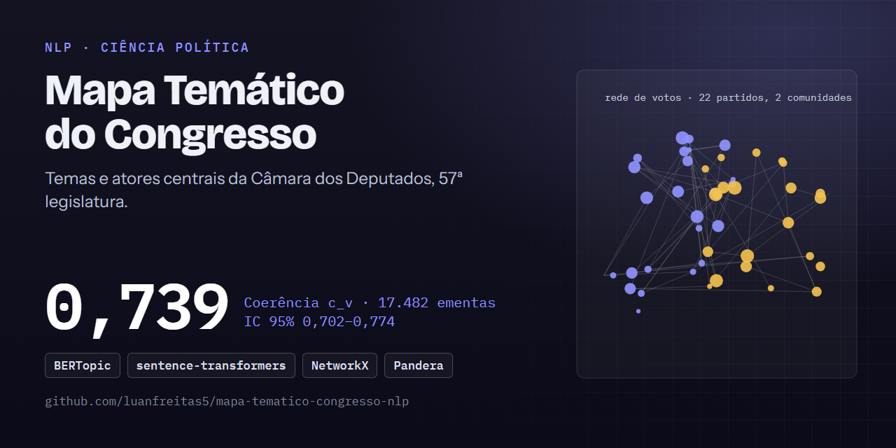
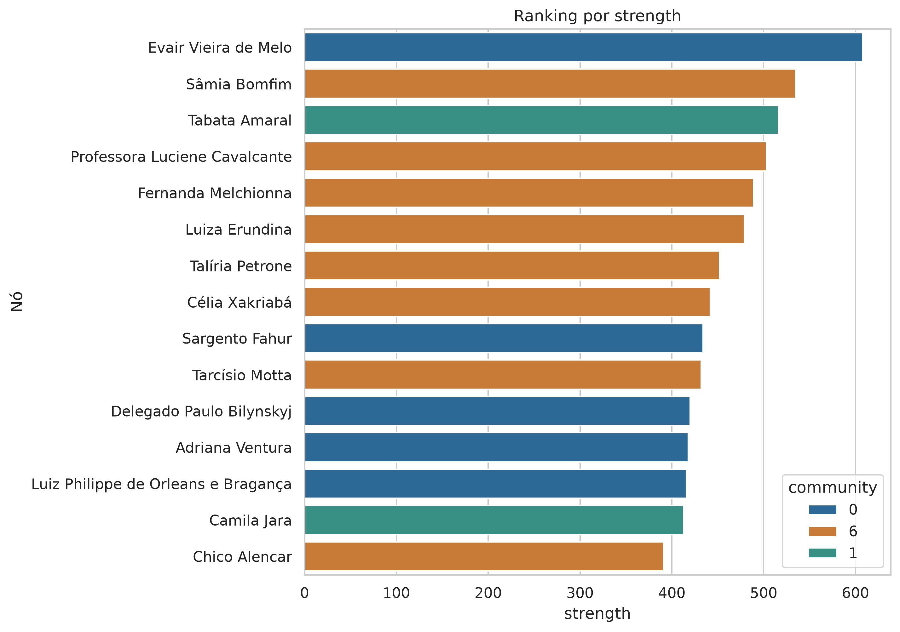

# 🏛️ Mapa Temático do Congresso: 122 tópicos nas ementas (c_v = 0,739) e as redes de poder da 57ª legislatura

[](https://github.com/luanfreitas5/mapa-tematico-congresso-nlp/actions/workflows/ci.yml)
[](https://codecov.io/gh/luanfreitas5/mapa-tematico-congresso-nlp)
[](https://luanfreitas5.github.io/mapa-tematico-congresso-nlp/)
[](LICENSE)
 <!-- = matriz do CI (tests.yml) -->

> **Resultado:** o BERTopic atinge coerência **c_v = 0,739 (IC 95%: 0,702–0,774)** nas ementas (17.482 documentos, 122 tópicos) e **0,666 (0,639–0,693)** nos discursos (44.269 documentos, 125 tópicos). **Ainda não há baseline (LDA/NMF)** para comparar, então não é possível afirmar que esses valores são bons — apenas que as ementas são mais coerentes e mais bem cobertas (25,3% de ruído) que os discursos (54,1%).



## 🎯 Problema

- **Quem decide o quê:** pesquisadores, jornalistas de dados e analistas de políticas públicas decidem onde aprofundar a leitura de milhares de proposições, votações e discursos por ano; o modelo aponta os temas dominantes, sua evolução e os atores centrais.
- **Pergunta:** quais **temas** aparecem nas ementas e nos discursos da 57ª legislatura, como sua frequência **muda ao longo do tempo** e quem são os atores **centrais** nas redes de **coautoria** (deputados) e de **alinhamento de votos** (partidos)?
- **Custo dos erros:** não há rótulo de referência; um tópico incoerente induz leitura errada do tema, e um documento no ruído (-1) deixa de ser coberto. **Métrica principal:** coerência `c_v` (proxy automática de interpretabilidade, complementada por `c_npmi`) mais a taxa de documentos no ruído, porque a coerência sozinha premia modelos que descartam muito texto.
- **Unidade e escopo:** um documento = uma ementa ou um discurso; 57ª legislatura, 2023-02 a 2025-12. Análise exploratória e descritiva, sem inferência causal.

## 🗂️ Dados

| Item | Valor |
|---|---|
| Fonte e licença | [API de Dados Abertos da Câmara (`api/v2`)](https://dadosabertos.camara.leg.br/api/v2) — dados públicos; termos no portal (ver Datasheet) |
| Tamanho / período | 882 deputados, 17.505 proposições, 44.528 discursos, 34.489 votações, 415.061 votos nominais; 2023-02 a 2025-12; snapshot de 2026-10-22 |
| Alvo e prevalência | não supervisionado (sem alvo); 25,3% das ementas e 54,1% dos discursos caem no ruído |
| Documentação | [Datasheet](reports/datasheets/camara_dados_abertos.md) |

Nenhum dado bruto é versionado no Git; cada snapshot tem SHA-256 em `data/bronze/manifest.json`. E-mail e foto dos deputados são descartados na silver (minimização, LGPD). Fontes, tipos de proposição (PT, PL, PLP, PEC, MPV) e período: [`configs/config.yaml`](configs/config.yaml).

## 📊 Resultados

Protocolo: pipeline único sobre o snapshot completo (sem conjunto de teste — modelo não supervisionado, avaliação *in-sample*), semente 42; IC 95% por bootstrap (2000 reamostragens) **sobre os tópicos**, excluindo o ruído (-1). Os números vêm de `data/gold/` (`coherence_*.parquet`, `doc_topics_*.parquet`, `network_*`), gerado localmente e fora do Git.

| Corpus | Documentos | Tópicos | No ruído (-1) | c_v (IC 95%) | c_npmi (IC 95%) |
|---|---|---|---|---|---|
| Baseline: LDA/NMF | — | — | — | **não executado** | **não executado** |
| Ementas (BERTopic) | 17.482 | 122 | 25,3% | **0,739 (0,702–0,774)** | 0,164 (0,135–0,192) |
| Discursos (BERTopic) | 44.269 | 125 | 54,1% | **0,666 (0,639–0,693)** | 0,047 (0,022–0,072) |

- **Diferença vs baseline:** não avaliada. Sem linha de base e sem teste de significância, não há como dizer se 0,739 é bom; a diferença ementas × discursos tem ICs que não se sobrepõem em `c_v`, mas os corpora têm registros distintos e não são diretamente comparáveis.
- **Pior segmento:** discursos (54,1% de ruído, `c_npmi` ≈ 0,05). Fatias por tipo de proposição e ano ainda não foram medidas (ver [Model Card](reports/model_cards/bertopic_congresso.md)).

**Corpus**

| Fonte | Registros brutos | Documentos modelados |
|---|---|---|
| Deputados | 882 | — |
| Proposições | 17.505 | 17.482 |
| Discursos | 44.528 | 44.269 |
| Votações / votos nominais | 34.489 / 415.061 | — |

**Tópicos**

- **Ementas — maiores:** Código Penal e crimes (817 docs), educação/LDB (412), datas comemorativas (387), transtorno do espectro autista (361), trânsito (280), imposto de renda (263), Banco Central (252), violência doméstica (249).
- **Discursos — maiores:** gestão municipal/prefeitos (1.892), violência contra a mulher (869 e 493, dois tópicos próximos), Rio Grande do Sul (656), Bolsonaro/golpe (559), educação (550 e 437), reforma tributária (481), saúde (443 e 402), religião (385).
- **Série temporal:** o volume mensal de ementas oscila (quedas em recessos, picos no início das legislaturas e no fim do ano); tópicos penais lideram quase todo o período, com pico de ~72 documentos/mês em meados de 2025.


**Redes**

| Rede | Nós | Arestas | Comunidades |
|---|---|---|---|
| Coautoria (deputados) | 617 | 9.230 (peso médio 2,2; máx. 56) | 172 (7 grandes: 177, 83, 56, 48, 33, 31, 21 nós; o resto são nós isolados ou pares) |
| Alinhamento de votos (partidos) | 22 | 199 (peso médio 0,79) | 2 (13 e 9 partidos) |

- **Coautoria, mais conectados (força):** Evair Vieira de Melo (REPUBLICANOS-ES, 608), Sâmia Bomfim (PSOL-SP, 535), Tabata Amaral (PSB-SP, 516). Por **intermediação** (ponte entre grupos): Evair Vieira de Melo (0,196), Flávia Morais (MDB-GO, 0,152) e Amom Mandel (REPUBLICANOS-AM, 0,089).
- **Estrutura:** a maior comunidade é dominada por PL (79 de 177), UNIÃO, PP e PSD; a segunda se organiza em torno do PT (20 de 83); uma comunidade menor é majoritariamente do PSOL (13 de 21). A coautoria segue o campo político, com muitas pontes entre partidos.
- **Alinhamento de votos:** rede quase completa (199 de 231 arestas possíveis, ~86% de densidade); centralidades muito próximas entre os partidos centrais (AVANTE, MDB, PSD, PODE, PP). Menos alinhados: NOVO (força 2,5), PL (7,3), PRD e REDE (~12,4). Por ser densa, a centralidade discrimina pouco: a informação útil está nas duas comunidades e nos partidos periféricos.



**Pendente:** revisão manual (amostras em `reports/review/` sem rótulos `is_coherent`, logo sem proporção de coerentes com IC de Wilson — [`docs/avaliacao.md`](docs/avaliacao.md)); baseline LDA/NMF; fatias por tipo/ano; sensibilidade de `min_edge_weight`, `min_cluster_size` e do limite de 30 autores; `reports/metrics/*.json` versionado com as métricas acima (hoje só existem nos parquets locais de `data/gold/`).

## 🔁 Reproduzir

Requisitos: [uv](https://docs.astral.sh/uv/), `make`, Python ≥ 3.10; acesso à internet (API pública, sem credenciais — `.env.example` só lista segredos opcionais). GPU é opcional: o `pyproject.toml` aponta o PyTorch para o índice CUDA 12.8; ajuste `[tool.uv.sources]` se usar CPU. Tempo: `TODO(owner): medir (ingestão + embeddings de ~62 mil textos)`.

```bash
git clone https://github.com/luanfreitas5/mapa-tematico-congresso-nlp.git
cd mapa-tematico-congresso-nlp
```

<!-- verify:start -->
```bash
uv sync --locked --all-groups --extra nlp
make pipeline   # ingest → preprocess → topics → networks → evaluate
```
<!-- verify:end -->

Saída esperada (snapshot da API de 2026-10-22, semente 42, `uv.lock` do commit `TODO(owner): sha`): ementas `c_v ≈ 0,739` e discursos `c_v ≈ 0,666`. Ingerir de novo grava um snapshot mais recente, cujos números podem diferir. Ambiente que gerou os resultados: `TODO(owner): versão do Python/SO`.

Etapas individuais: `make ingest`, `make preprocess`, `make topics`, `make networks`, `make evaluate`. Sem o extra de PLN, `make install` basta para ingestão, silver e redes.

- **Idempotência:** `make ingest` reaproveita snapshots; `make ingest REFRESH=1` grava um novo snapshot datado (os antigos nunca são alterados).
- **Reprodutibilidade:** semente 42, `PYTHONHASHSEED` exportado pelo Makefile, `uv.lock` commitado, SHA-256 de cada snapshot em `data/bronze/manifest.json`.
- **Qualidade:** `make test` (cobertura ≥ 80%), `make check` (lint, tipos, segurança, qualidade e testes — espelha o CI), `make hooks` (pre-commit rápido).

## 🧱 Estrutura

```text
API ─▶ bronze (snapshots + manifesto SHA-256) ─▶ silver (pandera) ─┬▶ embeddings ─▶ BERTopic ─▶ gold
                                                                    └▶ redes (NetworkX) ───────▶ gold

configs/   YAML validados por Pydantic           src/      código (imports a partir de src/)
data/      bronze | silver | gold (fora do Git)  tests/    pytest + hypothesis
notebooks/ exploração e relatório                docs/     MkDocs Material
reports/   figuras, revisão, datasheet, model card
```

Decisões de arquitetura em [`docs/arquitetura.md`](docs/arquitetura.md).

## ⚠️ Limitações

- **Sem baseline nem revisão manual:** a coerência automática é a única evidência de qualidade; não se sabe se os valores superam LDA/NMF nem se os tópicos são interpretáveis para humanos.
- **Avaliação in-sample, IC sobre tópicos:** o IC mede a variação entre tópicos, não entre re-execuções com outras sementes ou hiperparâmetros (UMAP/HDBSCAN) — sensibilidade não avaliada.
- **Acentos perdidos nos termos dos tópicos** (`cdigo penal`, `educao`, `providncias`): o vetorizador do c-TF-IDF descarta caracteres acentuados; afeta a legibilidade e possivelmente stopwords e coerência medida. Defeito a corrigir.
- **Ruído alto nos discursos:** 54,1% no tópico -1 e tópicos quase duplicados (violência contra a mulher, educação, saúde).
- **Ementas e discursos têm registros diferentes:** ementas curtas e formulaicas; discursos longos, truncados em 5000 caracteres. Tópicos não são comparáveis diretamente.
- **Data das proposições aproximada ao mês** da consulta (a listagem da API não traz a data).
- **Votos nominais apenas:** votações simbólicas não têm voto individual; a rede de partidos reflete só as nominais, que não são amostra aleatória. A rede é densa (~86%) e o limiar `min_edge_weight` influencia as centralidades.
- **Coautoria:** proposições com mais de 30 autores não geram arestas (evita cliques de bancada); a escolha afeta a rede.
- Um único revisor manual. Sem inferência causal: centralidade descreve estrutura, não influência.

## 📄 Licença e citação

MIT — ver [LICENSE](LICENSE). Sem artigo associado até o momento (sem `CITATION.cff`).
